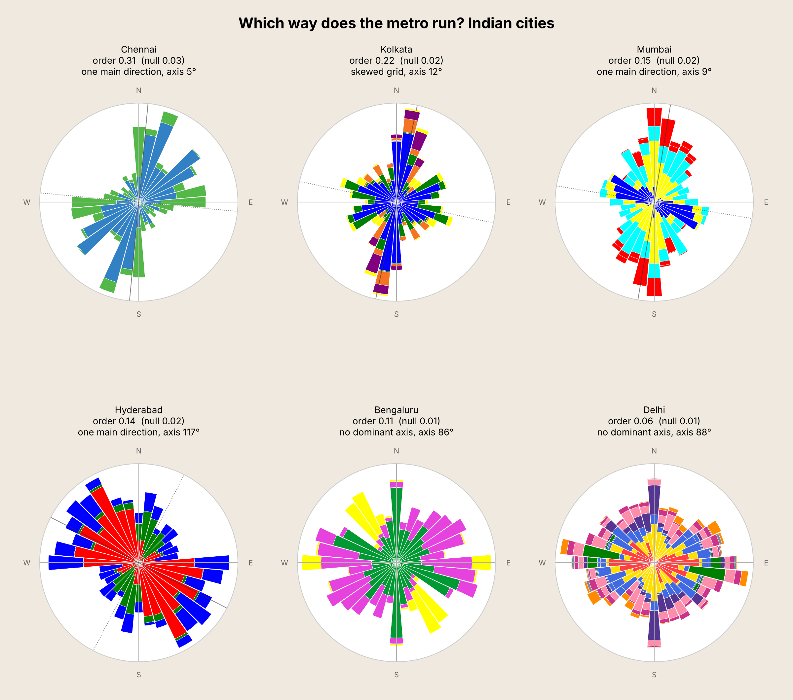

# Which way does the metro run? Indian cities

Compass orientation of every metro line in six Indian cities (Delhi, Kolkata,
Mumbai, Bengaluru, Chennai, Hyderabad), measured from OpenStreetMap track
geometry and drawn as polar "roses" in the style of Geoff Boeing's street
network orientation plots.



## Results

Data: OpenStreetMap, retrieved 4 November 2026. Sorted by orientation order.

| City | Lines | Track | Orientation order | Random baseline | Shape | Main axis | Tilt | Main / cross share |
|---|---|---|---|---|---|---|---|---|
| Chennai | 2 | 53 km | 0.31 | 0.03 | one main direction | 5° | 5° | 30% / 16% |
| Kolkata | 5 | 71 km | 0.22 | 0.02 | skewed grid | 12° | 12° | 41% / 15% |
| Mumbai | 6 | 85 km | 0.15 | 0.02 | one main direction | 9° | 9° | 35% / 14% |
| Hyderabad | 3 | 65 km | 0.14 | 0.02 | one main direction | 117° | 27° | 21% / 10% |
| Bengaluru | 3 | 95 km | 0.11 | 0.01 | no dominant axis | 86° | 4° | 21% / 14% |
| Delhi | 10 | 353 km | 0.06 | 0.01 | no dominant axis | 88° | 2° | 24% / 17% |

Full figures, including R2 and R4, are in [`out/summary.csv`](out/summary.csv).
One chart per city is in `out/`.

**These numbers describe the geometry of each network, not how good the metro
is.** A high orientation order means the track runs along one or two
directions; a low one means it spreads in every direction. A large network
with radial lines and a ring (Delhi) will score low, and that is usually what a
big city needs. Comparing metros on quality needs other measures: coverage,
accessibility to jobs, frequency, ridership and transfers.

A few readings:

- **Kolkata, Mumbai and Chennai lean north–south** (5–12° east of north),
  following the Hooghly in Kolkata and the coast in Mumbai and Chennai.
- **Delhi spreads most evenly.** Ten lines plus the Pink Line ring leave no
  dominant direction.
- **Hyderabad is the only city whose main axis is diagonal**, set by the Red
  and Blue lines.
- **Chennai's top score comes from only two lines.** Small networks look more
  ordered than they are (see Limitations).

## How it works

For each city the script:

1. Downloads metro route relations, with geometry, from the Overpass API.
2. Keeps one direction of each line, so parallel up and down tracks are not
   counted twice.
3. Splits the track into short segments and measures each segment's compass
   bearing and length.
4. Builds a 36-bin, length-weighted histogram of bearings. Bearings are treated
   as undirected (a north–south segment counts towards both N and S).
5. Computes the metrics below and draws the rose. **Bar area**, not bar length,
   is proportional to the share of track in that direction, and bars are
   stacked by line colour.

### What each number means

| Metric | Meaning |
|---|---|
| **Orientation order (φ)** | Boeing's measure, from the entropy of the bearing histogram. 0 = no preferred direction, 1 = a perfect two-axis grid. It ignores *which* way the track points, so a single tilted corridor can score as high as a grid. The metrics below fill that gap. |
| **Random baseline** | φ for the same segment lengths with random bearings. A rough check on whether a score could arise by chance. |
| **Main axis** | Compass bearing (0–180°) of the direction carrying the most track. |
| **Tilt** | How far that axis is from true north–south / east–west (0–45°). |
| **Main / cross share** | Share of track within ±15° of the main axis, and of its perpendicular. A grid splits these roughly evenly; a corridor puts most track on the main axis. |
| **R2** | How strongly track concentrates on **one** axis (0–1). High for a corridor; zero for both a uniform spread and a perfect grid. |
| **R4** | How strongly track concentrates on **two perpendicular** axes, or one (0–1). High for a grid or a corridor; low for a uniform spread. |
| **Shape** | A plain label from R2, R4 and the shares: *grid*, *skewed grid*, *one main direction*, or *no dominant axis*. |

The label thresholds (`R4_AXES`, `R2_ONE_AXIS`, `GRID_BALANCE`,
`SKEW_BALANCE` in the script) are judgement calls tuned so that real, curving
track is classified sensibly. They are not established cut-offs; change them
if you disagree with a label.

## Running it

```bash
pip install -r requirements.txt
python metro_orientation.py                 # all six cities
python metro_orientation.py delhi kolkata   # selected cities
python metro_orientation.py --all-tracks    # count every track, both directions
python metro_orientation.py --refresh       # re-download instead of using the cache
```

Outputs go to `out/`: one chart per city, `grid.png` and `summary.csv`.

The OpenStreetMap data used for the results above is included in `out/cache/`,
so the script reproduces these exact numbers without any download. Pass
`--refresh` to fetch current data; Overpass can take several minutes per city.

### Adding a city

Add an entry to `CITIES` at the top of the script with a bounding box
`(south, west, north, east)`, a `network` pattern matched against the route's
`network`, `operator` and `name` tags, and optionally an `exclude` pattern.
After running, check the city's inset map and the line lengths before trusting
the numbers.

## What is included and excluded

Only operating metro lines are counted. Routes OpenStreetMap tags as proposed,
under construction or disused are skipped. City-specific choices:

- **Delhi:** Delhi Metro (DMRC) lines only. RapidX, Noida Metro (Aqua Line) and
  Rapid Metro Gurgaon are separate systems and are excluded.
- **Mumbai:** Mumbai Metro lines only. The Navi Mumbai Metro (CIDCO) is a
  separate system and is excluded. Line 11 is mapped but was not in service.
- **Chennai:** Line 2A is excluded because it is an inter-corridor service
  running over Line 1 and Line 2 track; counting it would double-count that
  track. Lines 3, 4 and 5 were tagged as under construction.

## Limitations

- **The random baseline is too easy to beat.** It treats every short segment as
  independent, but consecutive segments along a line point the same way. Every
  city therefore beats it comfortably, and it understates how ordered a small
  network can look by chance. A better baseline would rotate whole lines at
  random.
- **Small networks look more ordered.** With two or three lines the histogram is
  lumpy, and lumpiness raises φ. Compare Chennai (2 lines) with Delhi (10
  lines) with care.
- **Geometry, not service.** Every metre of track counts equally. A long
  suburban tail weighs the same as a busy central section.
- **Track shape follows OpenStreetMap.** One direction of each line is used as a
  stand-in for its centreline; curves at junctions and mapping detail affect the
  result slightly.
- **A snapshot.** Results reflect OpenStreetMap tagging on 4 November 2026.
  Networks are expanding fast, and re-running with `--refresh` will change them.

## Credits

- Method: Geoff Boeing (2019), "Urban spatial order: street network orientation,
  configuration, and entropy", *Applied Network Science* 4, 67.
- Idea and chart design for applying it to metro lines: Martin Bangratz, in his
  #30DayMapChallenge 2026 (Day 2: Lines) post covering nine world cities, also
  shared on Reddit as *"[OC] Orientation of Metro Lines in Various World Cities"*.
- This repository adds the Indian cities and the rotation-aware axis metrics
  (main axis, tilt, main/cross share, R2, R4).
- Map data © [OpenStreetMap contributors](https://www.openstreetmap.org/copyright),
  available under the ODbL.

## Licence

Code: MIT (see `LICENSE`). Map data in `out/cache/`: ODbL, © OpenStreetMap
contributors.
